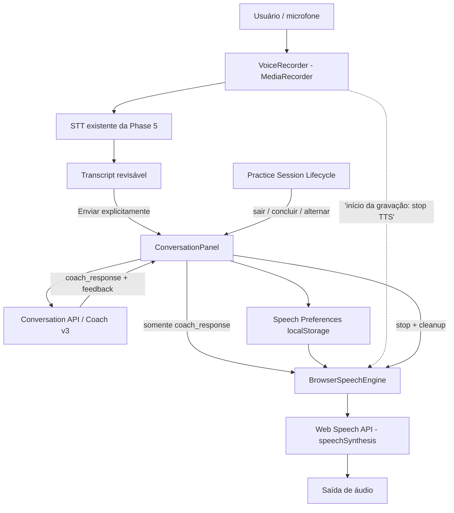
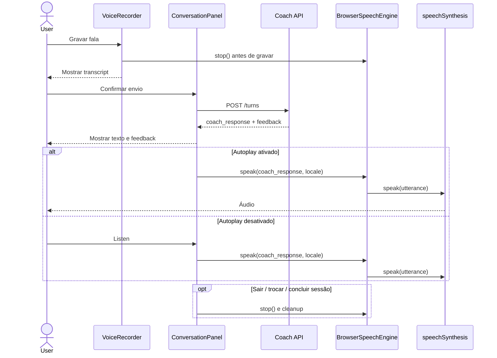

# Phase 6 — As-built Architecture & ADRs

**Estado:** descrição do desenho entregue por incrementos; baseada nos pacotes de código e nas validações relatadas, não em um novo checkout verificado do HEAD remoto.

## Arquitetura de alto nível

## Fronteiras e principais arquivos

| Arquivo | Responsabilidade |
|---|---|
| `frontend/src/services/browserSpeech.ts` | Encapsular síntese, voices, seleção regional, estado/assinaturas, cancelamento e proteção a eventos obsoletos |
| `frontend/src/services/speechPreferences.ts` | Preferências persistidas por navegador: voz regional, taxa, autoplay opcional |
| `frontend/src/components/ConversationPanel.tsx` | Controles por `coach_response`, vínculo ao turno, histórico, autoplay apenas para novo resultado e ciclo de vida do TTS |
| `frontend/src/components/PracticeSessionStarted.tsx` | Contexto da sessão, localidade efetiva, saída/conclusão e coordenação com gravador |
| `frontend/src/components/VoiceRecorder.tsx` | Captação e transcrição; callback para parar saída de áudio antes de gravar |
| `frontend/src/test/browserSpeech.test.ts` | Contrato TTS, seleção/fallback, lifecycle e erros |
| `frontend/src/test/CoachAudioPlayback.test.tsx` | Controles de reprodução por turno e lifecycle |
| `frontend/src/test/CoachVoicePreferences.test.tsx` | Voz/velocidade/autoplay e separação de histórico |
| `frontend/src/test/StrictModeSpeechLifecycle.test.tsx` | Proteção ao ciclo de vida React.StrictMode |

## ADR-001 — Browser TTS antes de provedor neural

**Decisão:** utilizar `speechSynthesis` e `SpeechSynthesisUtterance` para VOX-001.  
**Justificativa:** serviço gratuito do ponto de vista de cobrança direta de API TTS; integração inteiramente frontend e utilização do texto já gerado.  
**Trade-off:** disponibilidade/qualidade de voz variam por navegador e sistema; algumas implementações podem depender de rede e envolver serviços de terceiros.  
**Alternativa futura:** `TTSProvider` com backend neural e consentimento/orçamento explícitos.

## ADR-002 — Manual-first + autoplay opt-in

**Decisão:** autoplay inicialmente OFF, preferências locais, apenas respostas recém-geradas e enviadas pelo usuário; histórico e retomada silenciosos.  
**Justificativa:** evita reprodução surpresa, duplicação e riscos de UX/acessibilidade.  
**Risco:** políticas de autoplay/gesto do usuário diferem entre plataformas.

## ADR-003 — Audio boundary / session lifecycle

**Decisão:** uma engine para reproduzir um turno de cada vez, cancelar ao iniciar gravação, trocar/abandonar/concluir sessão ou desmontar painel.  
**Justificativa:** impede eco, fala de sessão anterior e eventos atrasados interferindo na sessão atual.  
**Hardening:** StrictMode não pode reutilizar engine já descartada; a limpeza definitiva é controlada, com testes de regressão.

## ADR-004 — Sem mudanças de schema/backend

**Decisão:** aproveitar `coach_response`, IDs e variantes de sessão da API existente. Preferências não sensíveis no `localStorage`.  
**Justificativa:** baixo custo, sem migrations e sem persistir áudio.  
**Limite:** preferências não sincronizam entre aparelhos/contas e podem desaparecer com limpeza do navegador.

## Contratos de segurança e privacidade

- Origem segura HTTPS confiável para microfone em aparelhos na LAN; `localhost` no mesmo computador é uma exceção de contexto potencialmente confiável.
- Evitar frontend HTTPS chamando backend HTTP diretamente (mixed content); preferir proxy de mesma origem e verificação de CORS.
- Não registrar `coach_response`, transcript ou áudio em logs de telemetria por padrão.
- O recurso Browser TTS não faz requisição explícita a uma API TTS proprietária do projeto, **mas não garante processamento exclusivamente offline**.
- O sistema de conversa e STT existentes podem efetuar requisições externas; custo e retenção seguem as respectivas integrações.

## Diagrama de sequência — nova resposta

